---
layout: default
title: "Infinity Pool"
description: "TryHackMe Infinity Pool penetration testing walkthrough covering web exploitation, command injection, internal service discovery, SSH tunneling, credential exposure, and Linux privilege escalation."
category: "TryHackMe | Penetration Testing"
tags:
  - TryHackMe
  - Linux
  - Web Security
  - Command Injection
  - Privilege Escalation
---

<div class="ctf-hero">

  <h1>Infinity Pool</h1>

  <p>
    A technical penetration testing walkthrough documenting the compromise
    lifecycle of the TryHackMe Infinity Pool laboratory, from external
    reconnaissance and OS command injection to internal infrastructure
    discovery, application pivoting, and root-level command execution.
  </p>

  <div class="ctf-badges">
    <span class="ctf-badge">TryHackMe</span>
    <span class="ctf-badge">Medium</span>
    <span class="ctf-badge">Linux</span>
    <span class="ctf-badge">Web Security</span>
    <span class="ctf-badge">Command Injection</span>
    <span class="ctf-badge">Privilege Escalation</span>
  </div>

</div>

## Navigation

<div class="ctf-toc">

<div class="ctf-toc-title">Documentation Map</div>

<ul>
<li><a href="#mission-and-executive-summary">Mission and Executive Summary</a></li>
<li><a href="#quick-overview">Quick Overview</a></li>
<li><a href="#assessment-objectives">Assessment Objectives</a></li>
<li><a href="#scope-and-responsible-use">Scope and Responsible Use</a></li>
<li><a href="#lab-architecture">Lab Architecture</a></li>
<li><a href="#threat-model-and-attack-surface">Threat Model and Attack Surface</a></li>
<li><a href="#assessment-methodology">Assessment Methodology</a></li>
<li><a href="#attack-progress-dashboard">Attack Progress Dashboard</a></li>
<li><a href="#reconnaissance">Reconnaissance</a></li>
<li><a href="#hidden-endpoint-discovery">Hidden Endpoint Discovery</a></li>
<li><a href="#initial-exploitation-and-access">Initial Exploitation and Access</a></li>
<li><a href="#linux-post-exploitation">Linux Post-Exploitation</a></li>
<li><a href="#internal-service-discovery">Internal Service Discovery</a></li>
<li><a href="#watchtower-dashboard">Watchtower Dashboard</a></li>
<li><a href="#configuration-api-enumeration">Configuration API Enumeration</a></li>
<li><a href="#ssh-local-port-forwarding">SSH Local Port Forwarding</a></li>
<li><a href="#freepbx-user-control-panel">FreePBX User Control Panel</a></li>
<li><a href="#voicemail-artifact-discovery">Voicemail Artifact Discovery</a></li>
<li><a href="#automation-api-investigation">Automation API Investigation</a></li>
<li><a href="#root-privilege-escalation">Root Privilege Escalation</a></li>
<li><a href="#complete-attack-chain">Complete Attack Chain</a></li>
<li><a href="#vulnerability-dashboard">Vulnerability Dashboard</a></li>
<li><a href="#mitre-attck-mapping">MITRE ATT&amp;CK Mapping</a></li>
<li><a href="#owasp-top-10-coverage">OWASP Top 10 Coverage</a></li>
<li><a href="#technology-stack-and-tools">Technology Stack and Tools</a></li>
<li><a href="#technical-skills-demonstrated">Technical Skills Demonstrated</a></li>
<li><a href="#blue-team-perspective">Blue Team Perspective</a></li>
<li><a href="#detection-opportunities">Detection Opportunities</a></li>
<li><a href="#security-recommendations">Security Recommendations</a></li>
<li><a href="#evidence-gallery">Evidence Gallery</a></li>
<li><a href="#learning-outcomes">Learning Outcomes</a></li>
<li><a href="#repository-resources">Repository Resources</a></li>
<li><a href="#conclusion">Conclusion</a></li>
<li><a href="#references">References</a></li>
<li><a href="#responsible-use">Responsible Use</a></li>
<li><a href="#author">Author</a></li>
</ul>

</div>

---

## Mission and Executive Summary

### Assessment Overview

Infinity Pool is a Linux-based TryHackMe penetration testing laboratory centered on web application exploitation, internal infrastructure discovery, and privilege escalation.

The documented environment simulates a hospitality organization in which operational applications and administrative services are accessible through internal interfaces. Initial access exposes additional attack surfaces that are not directly available through the external web application.

The assessment illustrates how multiple weaknesses can be chained together to compromise a host and reach privileged execution.

The documented attack lifecycle includes:

- External network reconnaissance and HTTP enumeration.
- Discovery of operational resources through `robots.txt`.
- Investigation of the `/status` and `/internal/` paths.
- OS command injection and reverse-shell access.
- Linux post-exploitation and internal service discovery.
- Investigation of the Watchtower operations dashboard.
- Configuration API enumeration.
- SSH local port forwarding to internal services.
- FreePBX User Control Panel investigation.
- Discovery of an authentication artifact in voicemail.
- Investigation of the Automation API.
- Authenticated command injection and root-level command execution.

The walkthrough emphasizes the relationship between application security, trust boundaries, credential handling, internal service exposure, and operating system privileges.

<div class="key-finding">

<div class="key-finding-title">Primary Security Finding</div>

The documented attack chain demonstrates how command injection, exposed internal configuration, authentication artifact exposure, and insufficiently restricted administrative functionality can combine to produce root-level command execution.

</div>

### Assessment Outcome

The source documentation records successful initial access, internal service investigation, credential-artifact discovery, and root privilege escalation.

Challenge flags, passwords, tokens, and sensitive credentials remain redacted in accordance with the original documentation.

---

## Quick Overview

<div class="ctf-card-grid">

  <div class="ctf-card">
    <div class="ctf-card-title">Platform</div>
    <div class="ctf-card-value">TryHackMe</div>
  </div>

  <div class="ctf-card">
    <div class="ctf-card-title">Challenge</div>
    <div class="ctf-card-value">Infinity Pool</div>
  </div>

  <div class="ctf-card">
    <div class="ctf-card-title">Difficulty</div>
    <div class="ctf-card-value">Medium</div>
  </div>

  <div class="ctf-card">
    <div class="ctf-card-title">Operating System</div>
    <div class="ctf-card-value">Linux</div>
  </div>

  <div class="ctf-card">
    <div class="ctf-card-title">Primary Focus</div>
    <div class="ctf-card-value">Web Security and Privilege Escalation</div>
  </div>

  <div class="ctf-card">
    <div class="ctf-card-title">Documented Outcome</div>
    <div class="ctf-card-value">Root-Level Command Execution</div>
  </div>

</div>

### Assessment Objectives

| Objective | Documented result |
|---|---|
| Identify publicly exposed services | Completed |
| Discover hidden application endpoints | Completed |
| Obtain command execution | Completed |
| Establish a reverse shell | Completed |
| Stabilize the shell | Completed |
| Enumerate local services | Completed |
| Investigate internal dashboards and APIs | Completed |
| Pivot to internal applications | Completed |
| Discover an authentication artifact | Completed |
| Achieve root-level command execution | Completed |
| Produce security documentation | Completed |

---

## Scope and Responsible Use

The assessment covers the activities documented in the original Infinity Pool walkthrough.

### Included activities

- External network and web enumeration.
- Hidden endpoint discovery.
- Web application exploitation.
- Linux post-exploitation.
- Internal service discovery.
- REST API investigation.
- SSH port forwarding.
- Credential-artifact discovery.
- Privilege escalation analysis.
- Security findings and defensive recommendations.

### Intentionally redacted information

The original documentation intentionally excludes the following sensitive material:

- User flag.
- Root flag.
- Passwords.
- API keys.
- Authentication tokens.
- Automation keys.
- Private keys and other sensitive credentials.

The purpose of this portfolio entry is to demonstrate methodology, technical reasoning, evidence organization, and security analysis rather than publish challenge answers or secrets.

---

## Lab Architecture

### Hospitality infrastructure

The documented Infinity Pool environment contains a public-facing hospitality portal and multiple internal services.

The following diagram consolidates the architecture and service relationships described in the source material. It is a conceptual representation, not a verified network topology.

```text
                         Internet
                            |
                            v
              Byte Lotus Hospitality Web Portal
                            |
                 +----------+----------+
                 |                     |
                 v                     v
          Public Landing Page     /status Endpoint
                                        |
                                        v
                               Command Injection
                                        |
                                        v
                                  Reverse Shell
                                        |
                                        v
                              Linux Operating System
                                        |
                  +---------------------+--------------------+
                  |                     |                    |
                  v                     v                    v
             Watchtower             FreePBX             Automation API
              TCP/3000              TCP/8080              TCP/9000
                  |                     |                    |
                  v                     v                    v
             Configuration       Voicemail System       Export Worker
                  |                     |                    |
                  +---------------------+--------------------+
                                        |
                                        v
                              Root-Level Execution
```

### Internal services

The original assessment identifies the following local services:

| Port | Service or role | Documented purpose |
|---:|---|---|
| 3000 | Watchtower | Internal operations dashboard |
| 8080 | FreePBX UCP | Telephony user control panel |
| 9000 | Automation API | Administrative automation and export worker |
| 3306 | MySQL | Internal database service |
| 5038 | Telephony service | Internal telephony functionality |

The original material does not provide service version numbers for these entries.

---

## Threat Model and Attack Surface

### External attack surface

The source identifies the following publicly exposed services:

| Port | Service | Role |
|---:|---|---|
| TCP/22 | SSH | Secure remote administration |
| TCP/80 | HTTP | Public web application |

The walkthrough begins with network reconnaissance and web application enumeration.

### Internal attack surface

The following applications and components were investigated after initial access:

| Component | Documented role | Security relevance |
|---|---|---|
| Watchtower | Operations dashboard | Internal status and configuration information |
| Watchtower configuration API | Configuration endpoint | Internal service references and infrastructure metadata |
| FreePBX UCP | Telephony administration interface | User interface and voicemail investigation |
| Voicemail system | Operational communication | Discovery of an authentication artifact |
| Automation API | Administrative service | Export worker and command-injection attack surface |
| MySQL | Database service | Internal storage |
| Telephony service | Telephony infrastructure | Internal service exposure |

### Security observation

> A service bound to localhost is not automatically trustworthy.

Local-only services may be inaccessible from the external network while remaining reachable by a process or user who already has access to the host.

If initial access is obtained through a web application, insufficient authentication and authorization on internal services can allow that access to be extended into other applications.

---

## Assessment Methodology

The assessment follows the phases documented in the original walkthrough.

| Phase | Objective |
|---|---|
| Reconnaissance | Identify exposed infrastructure |
| Enumeration | Discover web technologies and hidden resources |
| Vulnerability discovery | Identify insecure input handling |
| Exploitation | Obtain remote command execution |
| Initial access | Establish a Linux shell |
| Post-exploitation | Enumerate the operating system |
| Internal discovery | Identify localhost services |
| Pivoting | Investigate internal applications |
| Privilege escalation | Reach root-level execution |
| Reporting | Document findings and defensive controls |

The methodology combines external enumeration, application testing, host-level investigation, and analysis of internal trust relationships.

---

## Attack Progress Dashboard

| Assessment stage | Status |
|---|---|
| Network reconnaissance | Complete |
| Web enumeration | Complete |
| Hidden endpoint discovery | Complete |
| OS command injection | Complete |
| Reverse shell | Complete |
| Shell stabilization | Complete |
| Linux enumeration | Complete |
| Internal dashboard discovery | Complete |
| REST API enumeration | Complete |
| SSH tunnel pivot | Complete |
| Credential discovery | Complete |
| Root privilege escalation | Complete |

These statuses reflect the outcome recorded in the original source documentation.

---

## Reconnaissance

### Phase 1 — Initial web reconnaissance

The assessment begins with external service enumeration and inspection of the public web application.

The original documentation identifies Nmap as an enumeration tool and records HTTP fingerprinting and landing-page review as activities performed during this phase.

<figure>
  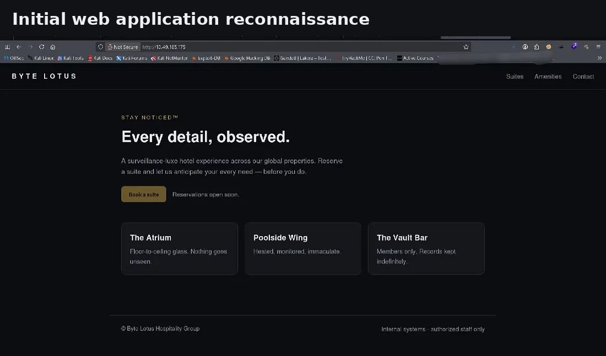
  <figcaption>Figure 1 — Initial web application reconnaissance.</figcaption>
</figure>

### Reconnaissance objectives

- Identify publicly exposed services.
- Inspect the HTTP landing page.
- Review application behavior.
- Identify resources that may reveal additional attack surfaces.

The original material does not include the exact Nmap command, scan output, target IP address, or detected service versions. These details are therefore not reconstructed.

---

## Hidden Endpoint Discovery

### Phase 2 — `robots.txt` investigation

The walkthrough records that `robots.txt` exposed operational resource paths.

The following paths were documented:

```text
/status
/internal/
```

<figure>
  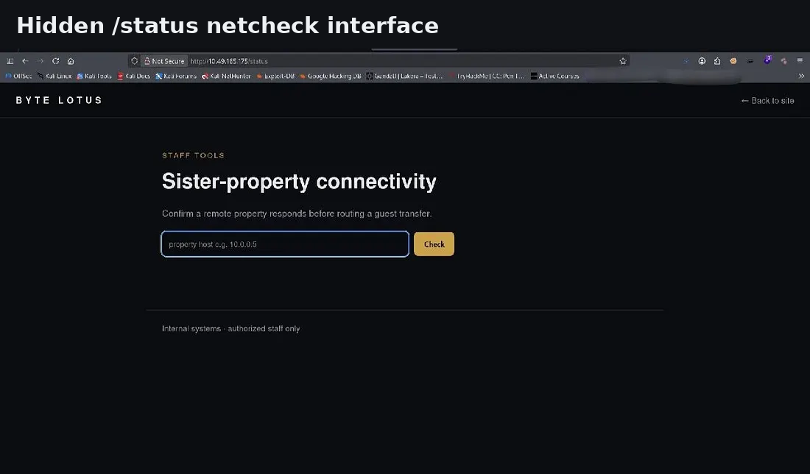
  <figcaption>Figure 2 — Hidden status endpoint discovery.</figcaption>
</figure>

### Security significance

The `robots.txt` file is intended to communicate crawler preferences. It does not enforce access control.

Operational endpoints referenced in a publicly accessible `robots.txt` file may reveal application structure to an unauthenticated visitor.

The discovery of `/status` provided the next investigation point and led to the documented command-injection finding.

---

## Initial Exploitation and Access

### Phase 3 — OS command injection

The original walkthrough records insecure input handling in the status functionality.

The application was vulnerable to OS command injection, allowing input to influence operating system command execution.

<figure>
  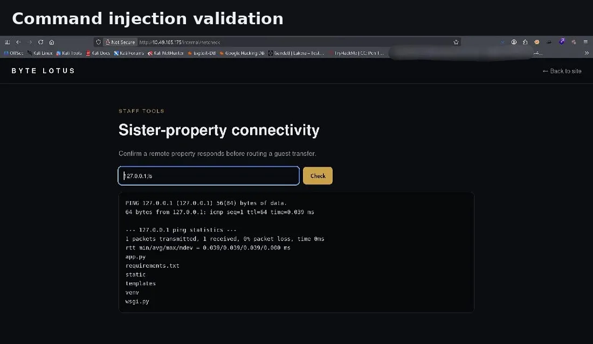
  <figcaption>Figure 3 — Command-injection investigation.</figcaption>
</figure>

### Security classification

| Attribute | Documented classification |
|---|---|
| Vulnerability | OS command injection |
| CWE | CWE-78 |
| OWASP category | A03 — Injection |
| Documented impact | Remote command execution |

### How the weakness affects security

OS command injection occurs when an application constructs or invokes operating system commands using untrusted input without safely separating data from executable command syntax.

If an attacker can control the resulting command, the application may execute operations beyond its intended function.

The impact depends on the privileges of the vulnerable process, the surrounding system configuration, and the attacker's ability to reach the affected functionality.

### Phase 4 — Reverse-shell access

The source records that exploitation resulted in an interactive Linux shell.

<figure>
  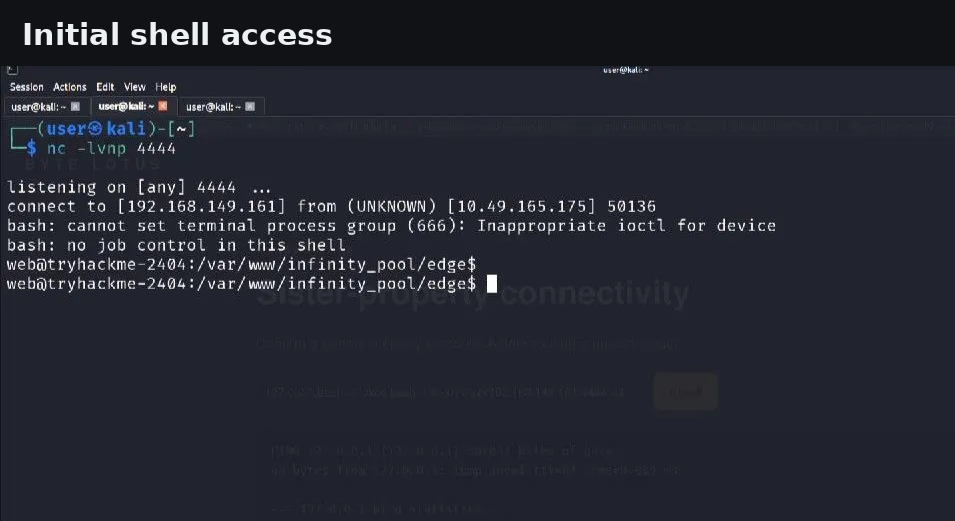
  <figcaption>Figure 4 — Reverse-shell access following initial exploitation.</figcaption>
</figure>

The walkthrough then proceeds to shell stabilization, user enumeration, and filesystem discovery.

The original source does not contain the exact exploit payload, listener command, callback address, or callback port. These values are not invented in this document.

<div class="attack-chain">

  <div class="attack-step">Web Enumeration</div>
  <div class="attack-arrow">→</div>
  <div class="attack-step">Hidden Endpoint</div>
  <div class="attack-arrow">→</div>
  <div class="attack-step">Command Injection</div>
  <div class="attack-arrow">→</div>
  <div class="attack-step">Reverse Shell</div>

</div>

---

## Linux Post-Exploitation

### Phase 5 — Host and service enumeration

After obtaining shell access, the documented methodology moves to Linux post-exploitation.

The objectives include:

- Stabilizing the shell with a pseudo-terminal (PTY).
- Enumerating the current user and environment.
- Investigating the filesystem.
- Identifying local services.
- Discovering administrative interfaces that are not externally exposed.

<figure>
  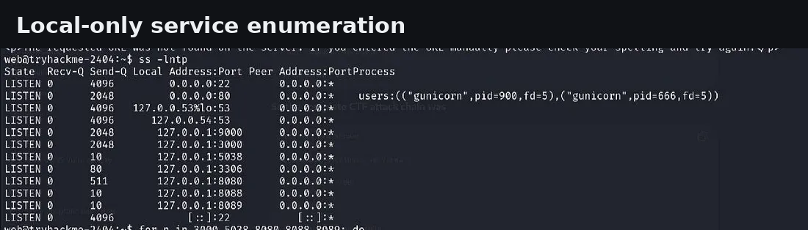
  <figcaption>Figure 5 — Internal service discovery during Linux post-exploitation.</figcaption>
</figure>

### Internal service discovery

The original walkthrough records the following services:

| Port | Service |
|---:|---|
| 3000 | Watchtower |
| 8080 | FreePBX UCP |
| 9000 | Automation API |
| 3306 | MySQL |
| 5038 | Telephony service |

### Why this phase matters

External reconnaissance describes what is reachable from outside a target. Host-level enumeration can expose a different set of applications and trust relationships.

A web application compromise can become substantially more serious when the compromised process can access local administrative interfaces, databases, or automation workers.

---

## Watchtower Dashboard

### Phase 6 — Internal operations dashboard

Watchtower was identified as an internal operations and monitoring dashboard accessible from within the compromised host.

<figure>
  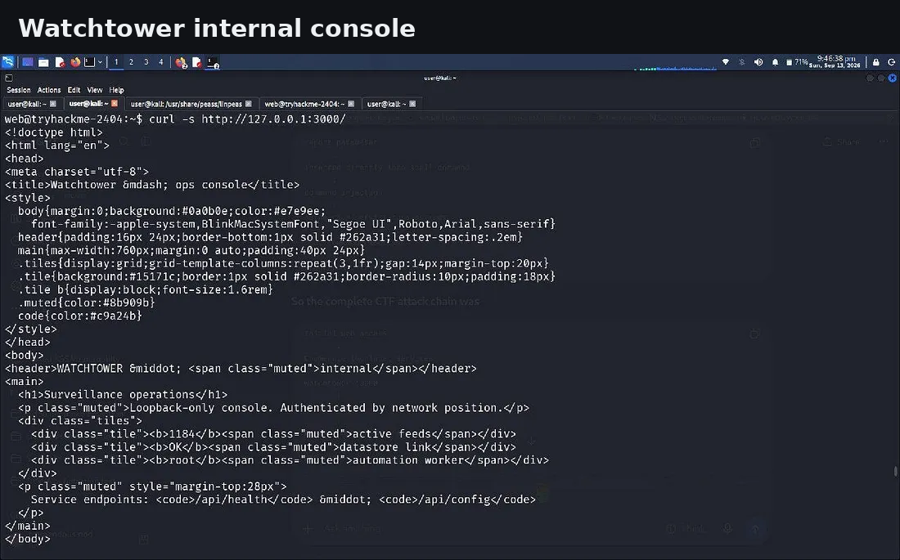
  <figcaption>Figure 6 — Watchtower internal operations dashboard.</figcaption>
</figure>

### Documented observations

| Component | Observation |
|---|---|
| Dashboard | Internal infrastructure monitoring interface |
| Status feed | Operational service-health information |
| REST API | Health and configuration endpoints |
| Administrative notes | Infrastructure metadata |

### Security observation

The source describes a trust assumption in which local requests were treated as trustworthy.

Localhost binding can reduce direct network exposure, but it does not establish the identity or authorization of the requesting process.

A secure design must enforce authentication and authorization independently of network location.

---

## Configuration API Enumeration

### Phase 7 — Configuration disclosure

The configuration endpoint exposed internal infrastructure relationships.

<figure>
  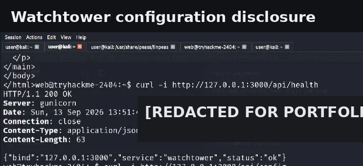
  <figcaption>Figure 7 — Watchtower configuration API investigation.</figcaption>
</figure>

### Documented information exposure

| Information exposed | Original assessment rating |
|---|---|
| Internal service URLs | High |
| Telephony portal references | High |
| Automation worker references | High |
| Administrative notes | Medium |
| Infrastructure metadata | Medium |

These ratings are reproduced from the original source's configuration-disclosure table. They are not presented as independently calculated CVSS scores.

### Security finding — Sensitive configuration disclosure

| Attribute | Value |
|---|---|
| Category | Information disclosure |
| CWE | CWE-200 |
| Original severity | High |
| Potential impact | Disclosure of internal infrastructure information |

Configuration data can reveal service relationships and operational details that help an attacker identify further targets after an initial compromise.

The defensive objective is to prevent unauthorized users and processes from obtaining sensitive configuration data, credentials, and internal service references.

---

## SSH Local Port Forwarding

### Phase 8 — Internal service access

The walkthrough documents SSH local port forwarding as the mechanism used to access internal services from the assessment environment.

<figure>
  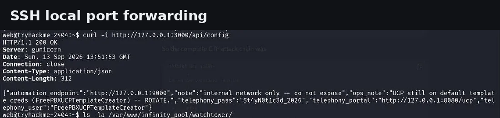
  <figcaption>Figure 8 — SSH local port-forwarding investigation.</figcaption>
</figure>

### Documented tunnel architecture

```text
Kali Linux
    |
    +---- localhost:3000
    |
    +---- localhost:8080
    |
    +---- localhost:9000
    |
    v
 SSH Local Tunnel
    |
    v
127.0.0.1 Services
    |
    v
Target Linux Host
```

### Assessment benefits

- Browser access to internal dashboards.
- Investigation of REST APIs.
- Interaction with internal applications.
- Access to localhost-bound services through a tunnel.

### Security considerations

SSH forwarding can be a legitimate administrative capability, but it can also provide a path to internal services when an attacker controls an account or process capable of establishing a tunnel.

Defenders should monitor unusual forwarding activity, constrain forwarding where appropriate, and review which users can access internal administrative interfaces.

The source does not provide the exact SSH command, account name, or authentication method used for the tunnel.

---

## FreePBX User Control Panel

### Phase 9 — Telephony application investigation

The original walkthrough records investigation of the FreePBX User Control Panel (UCP).

<figure>
  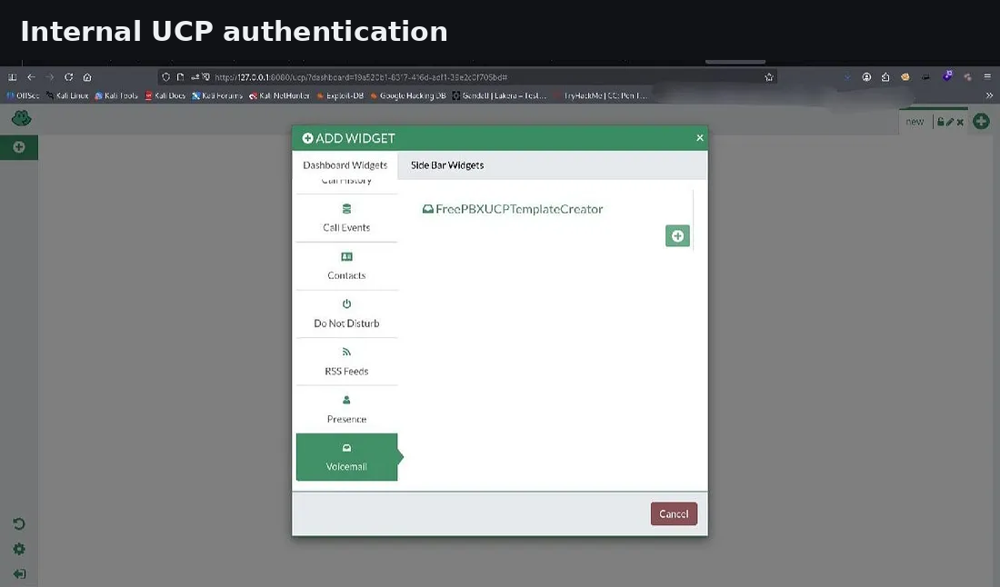
  <figcaption>Figure 9 — FreePBX User Control Panel investigation.</figcaption>
</figure>

### Areas investigated

| Section | Documented purpose |
|---|---|
| Dashboard | User overview |
| Voicemail | Internal messages |
| Settings | Account configuration |
| Notifications | Operational communication |

### Security perspective

Internal collaboration and telephony applications can contain operational communications and authentication-related material.

Once an attacker gains access to an internal application, data that appears unrelated to the initial vulnerability may become relevant to the broader attack chain.

The original walkthrough proceeds from the UCP investigation to voicemail artifact discovery.

---

## Voicemail Artifact Discovery

### Phase 10 — Authentication artifact

The source records discovery of an operational authentication artifact in voicemail that was associated with the automation platform.

<figure>
  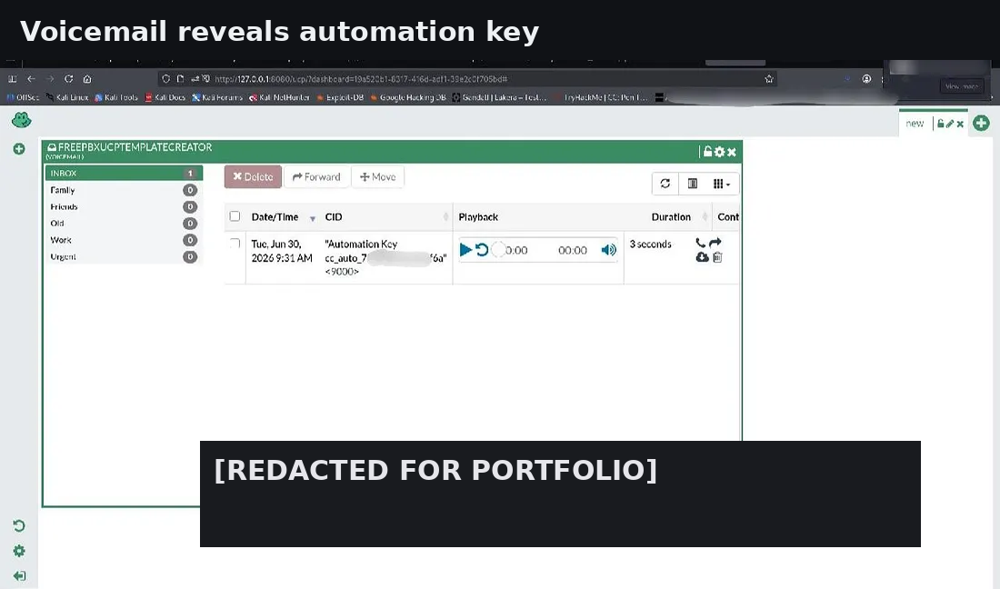
  <figcaption>Figure 10 — Authentication artifact discovery associated with the automation service.</figcaption>
</figure>

### Security significance

Authentication material exposed through operational communications can allow access to services beyond the application where it was discovered.

The risk depends on the artifact's permissions, scope, validity, and the controls protecting the associated service.

The original walkthrough intentionally redacts the actual artifact.

### Portfolio redaction policy

The following material remains excluded:

- API keys.
- Authentication tokens.
- Passwords.
- User flag.
- Root flag.
- Automation keys.
- Sensitive credentials.

No attempt has been made to reconstruct these values.

---

## Automation API Investigation

### Phase 11 — Administrative automation service

The Automation API exposed administrative functionality associated with an export worker.

<figure>
  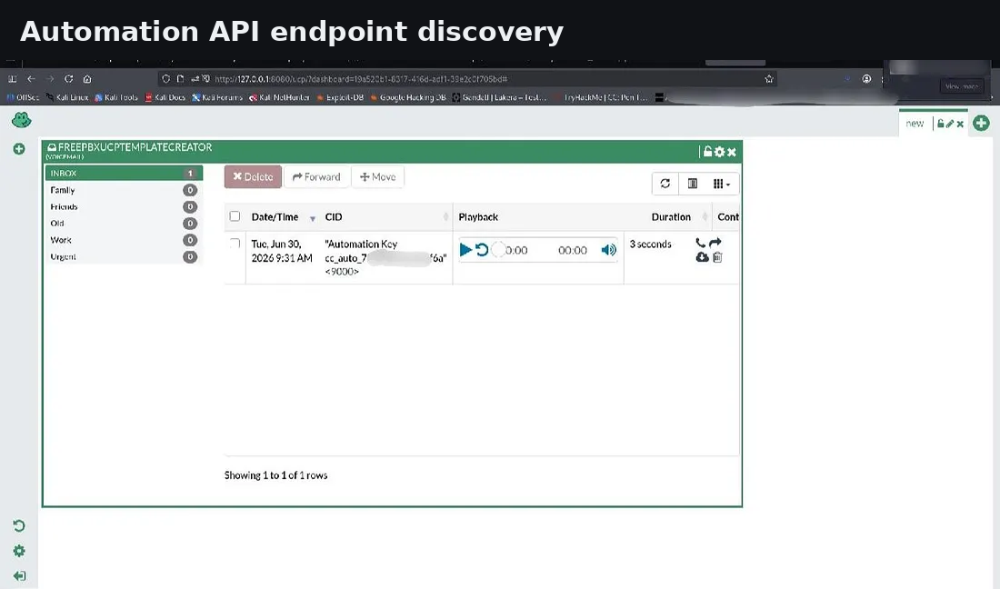
  <figcaption>Figure 11 — Automation API investigation.</figcaption>
</figure>

### Documented API endpoints

| Endpoint | Documented purpose |
|---|---|
| `/health` | Service health |
| `/jobs/export` | Export worker |
| Internal APIs | Administrative operations |

### Security observation

The original walkthrough identifies an export endpoint that constructed operating system commands using user-controlled input.

This introduced a second command-injection issue into the documented attack chain.

The distinction between the initial command-injection issue and the authenticated automation endpoint is important: the latter is described in the source as requiring authentication and enabling root-level command execution.

The source does not include the exact HTTP request, authentication header, payload, or API response. Those details are not reconstructed.

---

## Root Privilege Escalation

### Phase 12 — Root-level command execution

The documented assessment concludes with authenticated command injection in the automation service and root-level command execution.

<figure>
  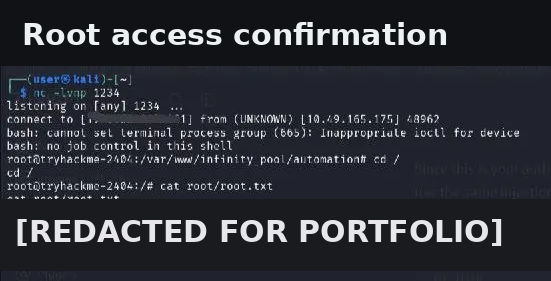
  <figcaption>Figure 12 — Root-level command execution following the documented privilege-escalation path.</figcaption>
</figure>

### Final assessment outcome

| Objective | Documented status |
|---|---|
| Root-level command execution | Achieved |
| Privilege escalation | Successful |
| Challenge flag | Redacted |

### Escalation path

<div class="attack-chain">

  <div class="attack-step">Initial Shell</div>
  <div class="attack-arrow">→</div>
  <div class="attack-step">Internal Enumeration</div>
  <div class="attack-arrow">→</div>
  <div class="attack-step">Credential Artifact</div>
  <div class="attack-arrow">→</div>
  <div class="attack-step">Automation API</div>
  <div class="attack-arrow">→</div>
  <div class="attack-step">Authenticated Command Injection</div>
  <div class="attack-arrow">→</div>
  <div class="attack-step">Root Execution</div>

</div>

The source documents the successful outcome but does not provide the exact vulnerable source code, exploit request, command payload, or detailed process-privilege configuration.

---

## Complete Attack Chain

The following diagram consolidates the full documented compromise lifecycle.

```text
External Reconnaissance
          |
          v
HTTP Enumeration
          |
          v
robots.txt Discovery
          |
          v
/status and /internal/
          |
          v
OS Command Injection
          |
          v
Reverse Shell
          |
          v
Linux Post-Exploitation
          |
          v
Internal Service Discovery
          |
          v
Watchtower Dashboard
          |
          v
Configuration Disclosure
          |
          v
SSH Local Port Forwarding
          |
          v
FreePBX UCP
          |
          v
Voicemail Authentication Artifact
          |
          v
Automation Authentication
          |
          v
Automation API
          |
          v
Authenticated Command Injection
          |
          v
Root-Level Command Execution
```

<figure>
  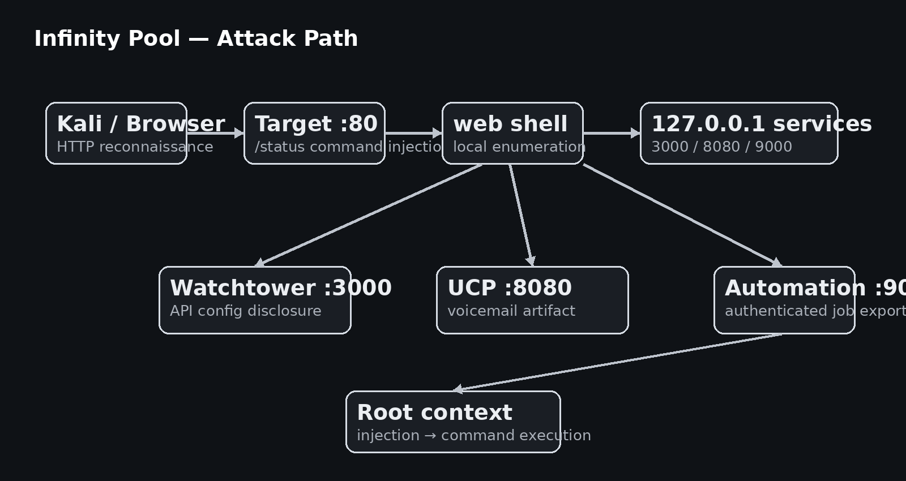
  <figcaption>Figure 13 — Original documented attack-path overview.</figcaption>
</figure>

### Attack-chain interpretation

The progression demonstrates three important security relationships:

1. **Initial access creates visibility.** A web application vulnerability can provide an attacker with an execution context on the underlying operating system.

2. **Internal services expand the attack surface.** Applications that are inaccessible from the external network may become reachable from a compromised host or through authorized forwarding mechanisms.

3. **Credential exposure and unsafe command construction can amplify impact.** Authentication material found in an operational application may enable access to another service, where an additional injection weakness can lead to more privileged execution.

---

## Vulnerability Dashboard

The following findings reproduce the classifications recorded in the original documentation.

| Finding | Original severity | CWE |
|---|---|---|
| OS command injection | High | CWE-78 |
| Configuration disclosure | High | CWE-200 |
| Credential exposure | High | CWE-522 |
| Localhost trust-boundary abuse | High | CWE-284 |
| Authenticated command injection | Critical | CWE-78 |

The severity labels above are source-reported classifications, not independently validated ratings.

### Finding 1 — OS command injection

**Evidence:** The source documents command injection through the status functionality, followed by reverse-shell access.

**Impact:** Remote command execution within the privileges available to the vulnerable application process.

**Recommended control:** Avoid shell-based command construction. Use safe process APIs, strict input validation, and least-privilege execution.

### Finding 2 — Configuration disclosure

**Evidence:** The Watchtower configuration endpoint exposed internal service references and infrastructure metadata.

**Impact:** Internal infrastructure information became available for subsequent enumeration and pivoting.

**Recommended control:** Restrict configuration endpoints and remove secrets and unnecessary infrastructure details from responses.

### Finding 3 — Credential exposure

**Evidence:** The source documents an authentication artifact discovered through voicemail and associated with the automation platform.

**Impact:** Exposed authentication material may allow access to additional services, depending on its permissions and validity.

**Recommended control:** Store credentials in a dedicated secrets-management system, restrict access, and rotate exposed artifacts.

### Finding 4 — Localhost trust-boundary abuse

**Evidence:** Internal applications were investigated after obtaining shell access, and local services became accessible through SSH forwarding.

**Impact:** Network-location assumptions may permit unauthorized access when authentication and authorization controls are insufficient.

**Recommended control:** Authenticate and authorize access to internal services independently of whether requests originate from localhost.

### Finding 5 — Authenticated command injection

**Evidence:** The Automation API export endpoint was documented as constructing operating system commands from user-controlled input. The source records root-level execution as the final result.

**Impact:** Administrative command execution with root-level consequences.

**Recommended control:** Eliminate unsafe shell invocation, validate structured request data, and run automation workers with the minimum privileges required.

---

## MITRE ATT&CK Mapping

The original source provides the following ATT&CK technique mappings. They are retained here as source-documented mappings rather than independently verified classifications.

| Technique ID | Source-provided technique | Documented context |
|---|---|---|
| T1595 | Active Service Scanning | External reconnaissance |
| T1190 | Exploit Public-Facing Application | Initial web application exploitation |
| T1059.004 | Unix Shell | Shell-based command execution |
| T1105 | Ingress Tool Transfer | Included in the original mapping; specific transfer evidence is not supplied |
| T1046 | Network Service Discovery | Internal service enumeration |
| T1021.004 | SSH Remote Services | SSH-based internal access and forwarding |
| T1552 | Unsecured Credentials | Authentication artifact discovery |
| T1078 | Valid Accounts | Authenticated access to the automation service |
| T1068 | Privilege Escalation | Included in the original mapping; the specific privilege-escalation mechanism is not fully documented |

A mapping's inclusion in the original writeup does not, by itself, establish that all required technique-specific evidence has been captured. A formal assessment should validate each mapping against the actual actions and evidence.

---

## OWASP Top 10 Coverage

The original documentation associates the following categories with the assessment.

| OWASP category | Source-documented context |
|---|---|
| A01 — Broken Access Control | Localhost trust assumptions and internal access |
| A03 — Injection | Command-injection vulnerabilities |
| A05 — Security Misconfiguration | Configuration endpoint exposure |
| A07 — Authentication Failures | Operational credential exposure |
| A09 — Logging & Monitoring Failures | Detection gaps involving shell execution |

These are the categories cited by the original report. The table records the source's classifications rather than claiming that every category has been independently validated against a specific OWASP edition.

---

## Technology Stack and Tools

### Documented technologies

| Technology | Role |
|---|---|
| Linux | Target operating system |
| Gunicorn | Python web server |
| Python | Backend application technology |
| Watchtower | Internal operations dashboard |
| FreePBX | Internal telephony platform |
| REST API | Application and automation interface |
| OpenSSH | SSH access and local port forwarding |
| Netcat | Reverse-shell listener |

### Documented assessment tooling

| Tool or technology | Documented use |
|---|---|
| Nmap | Network reconnaissance and service enumeration |
| SSH / OpenSSH | Local port forwarding |
| Netcat | Reverse-shell listener |
| Linux shell utilities | Host and environment investigation |
| HTTP interfaces | Web application and API investigation |

The source does not provide the complete original command history or tool-version information. This inventory therefore does not introduce additional tools or claim that undocumented commands were executed.

---

## Technical Skills Demonstrated

### Offensive security

- Network reconnaissance.
- HTTP and web application enumeration.
- Hidden endpoint discovery.
- OS command-injection analysis.
- Reverse-shell access.
- Linux post-exploitation.
- Internal service discovery.
- SSH local port forwarding.
- REST API investigation.
- Authentication artifact discovery.
- Privilege-escalation analysis.

### Security engineering and analysis

- Attack-surface mapping.
- Internal trust-boundary analysis.
- Configuration-disclosure assessment.
- Credential-exposure analysis.
- CWE classification.
- OWASP category mapping.
- MITRE ATT&CK mapping review.
- Risk analysis.
- Defensive detection planning.
- Security hardening recommendations.
- Evidence-based technical reporting.

---

## Blue Team Perspective

The Infinity Pool attack chain provides several useful defensive investigation points.

A defensive review should correlate application activity, process creation, authentication events, network connections, and access to internal services instead of examining each event in isolation.

### Detection Opportunities

| Detection area | What to investigate |
|---|---|
| Web application process execution | Unexpected child processes spawned by Gunicorn or Python workers |
| Reverse-shell behavior | Unexpected outbound TCP connections and shell processes |
| SSH forwarding | Unusual local forwarding sessions and access to internal administrative ports |
| Configuration API access | Unexpected requests for configuration data and internal service references |
| FreePBX and voicemail access | Unusual access to operational messages and authentication-related artifacts |
| Export API activity | Repeated or abnormal requests to `/jobs/export` |
| Automation worker execution | Unexpected shell commands launched by the automation service |
| Privileged execution | Commands executed with root privileges by application or automation processes |

### Suspicious process investigation

The original documentation identifies the following process names as relevant to its defensive hunting discussion:

```text
bash
sh
python
curl
tar
nc
```

Investigate whether these processes were launched unexpectedly by:

- Gunicorn.
- Python application workers.
- The automation service.

These process names are investigation leads, not proof of malicious activity. Their significance depends on parent-child relationships, command-line arguments, execution context, and surrounding events.

### Network investigation

The original source highlights the following indicators for review:

```text
SSH -L
127.0.0.1:3000
127.0.0.1:8080
127.0.0.1:9000
```

These values identify the forwarding pattern and internal ports documented in the walkthrough. They are not independently verified indicators of compromise.

### API abuse investigation

Review:

- Repeated requests to `/jobs/export`.
- Unusual report names.
- Authentication anomalies.
- Unexpectedly long-running export jobs.
- Application workers launching shell processes.
- Requests that produce unexpected changes in execution behavior.

### Defensive correlation

A useful investigation sequence is to correlate:

1. The originating HTTP request.
2. The application process handling that request.
3. Any child process created by the application.
4. Subsequent outbound connections.
5. Authentication activity against internal services.
6. Access to configuration or voicemail data.
7. Execution activity associated with the automation worker.

This approach can help defenders reconstruct a multi-stage intrusion rather than treating each event as an isolated alert.

---

## Security Recommendations

The following recommendations derive from the documented findings.

### 1. Web application security

| Finding | Recommended control |
|---|---|
| Command injection | Remove unnecessary shell execution and use safe process APIs |
| Untrusted command parameters | Validate inputs against strict allow-lists and expected data types |
| Unsafe destination selection | Restrict permitted destinations and reject untrusted host parameters |
| Excessive process privileges | Run web application workers with least privilege |

### 2. API security

| Finding | Recommended control |
|---|---|
| Internal API exposure | Enforce authentication and authorization on administrative APIs |
| Configuration disclosure | Restrict sensitive responses and remove unnecessary infrastructure details |
| Unsafe export processing | Use structured input and avoid shell-based command construction |
| Excessive administrative functionality | Restrict endpoints and permissions to the minimum required |

### 3. Secrets management

| Finding | Recommended control |
|---|---|
| Authentication artifact exposure | Store secrets in a dedicated secrets-management system |
| Exposed credentials or tokens | Revoke or rotate affected artifacts |
| Sensitive operational communications | Avoid storing reusable credentials in voicemail or ordinary messages |
| Broad credential access | Apply least privilege and service-specific authentication |

### 4. Infrastructure security

| Finding | Recommended control |
|---|---|
| Localhost trust assumptions | Enforce identity and authorization checks |
| Internal service exposure | Restrict access using network controls and application-level policies |
| Excessively privileged automation | Run automation workers with minimum required permissions |
| Unmonitored internal activity | Audit administrative services and correlate access with process execution |
| Unnecessary forwarding capabilities | Restrict SSH forwarding according to operational requirements |

### Hardening Checklist

The following checklist converts the original hardening recommendations into implementation-oriented controls.

- [ ] Validate user input at application boundaries.
- [ ] Remove unnecessary shell execution.
- [ ] Sanitize or strictly validate host parameters.
- [ ] Allow-list permitted destinations.
- [ ] Use safe subprocess execution.
- [ ] Authenticate internal APIs.
- [ ] Validate API request schemas.
- [ ] Restrict administrative endpoints.
- [ ] Remove secrets from configuration responses.
- [ ] Rotate exposed authentication artifacts.
- [ ] Use centralized secret management.
- [ ] Apply least privilege to automation workers.
- [ ] Implement network segmentation where appropriate.
- [ ] Enforce service-to-service authentication.
- [ ] Audit localhost-bound administrative services.
- [ ] Monitor suspicious application child processes and privileged execution.

The checklist is a set of recommended remediation tasks, not a claim that these controls have already been implemented.

---

## Evidence Gallery

The gallery preserves the original screenshot paths and groups the evidence by assessment phase.

### External reconnaissance

| Evidence | Description |
|---|---|
|  | Initial landing page |
|  | Status endpoint discovery |

### Initial exploitation

| Evidence | Description |
|---|---|
|  | Command-injection investigation |
|  | Reverse-shell access |

### Internal enumeration

| Evidence | Description |
|---|---|
|  | Internal service enumeration |
|  | Watchtower operations dashboard |

### Internal pivoting

| Evidence | Description |
|---|---|
|  | Configuration API investigation |
|  | SSH forwarding investigation |

### Credential discovery

| Evidence | Description |
|---|---|
|  | FreePBX UCP investigation |
|  | Redacted authentication-artifact evidence |

### Privilege escalation

| Evidence | Description |
|---|---|
|  | Automation API investigation |
|  | Root-level execution evidence |

### Attack-path overview


*Figure 13 — Original attack-path overview.*

All image references above retain the original relative paths. The screenshots must remain available at those paths within the `docs/` directory for the GitHub Pages documentation to render correctly.

---

## Learning Outcomes

The documented assessment provides practical experience in the following areas.

### Web application security

- Investigating exposed web resources.
- Discovering operational endpoints.
- Understanding OS command injection.
- Relating application vulnerabilities to operating system execution.

### Linux post-exploitation

- Stabilizing an interactive shell.
- Enumerating the host environment.
- Discovering local services.
- Investigating application processes and internal interfaces.

### Internal infrastructure security

- Understanding localhost trust boundaries.
- Investigating internal dashboards and REST APIs.
- Using SSH forwarding to reach internal services.
- Assessing the consequences of exposed configuration.

### Credential and privilege analysis

- Recognizing authentication artifacts in operational applications.
- Understanding credential chaining across services.
- Identifying unsafe command construction in administrative workers.
- Analyzing the impact of root-level execution.

### Defensive security

- Identifying useful process and network telemetry.
- Mapping documented activity to security frameworks.
- Deriving remediation controls from observed weaknesses.
- Organizing technical evidence into a structured report.

---

## Repository Resources

The original documentation references the following repository resources.

| Resource | Purpose |
|---|---|
| `README.md` | Repository landing page |
| `Documentation/Documentation.md` | Complete penetration testing report |
| `Documentation/Infinity_Pool_Documentation.docx` | Professional report document |
| `Resources/notes.md` | Quick methodology notes |
| `SECURITY.md` | Responsible disclosure policy |

These are references retained from the original source. Their presence or current contents have not been independently verified.

---

## Conclusion

Infinity Pool demonstrates how a series of weaknesses across application and infrastructure boundaries can create a path from initial web exploitation to privileged command execution.

The documented progression begins with endpoint discovery and OS command injection. Following initial access, host enumeration exposes internal services and administrative applications. Configuration disclosure and authentication-artifact discovery then provide additional context for investigating the Automation API, where a second command-injection weakness leads to the documented root-level outcome.

The central security lessons are:

- Input must never be treated as safe merely because it originates from an internal interface.
- Localhost binding is not a replacement for authentication and authorization.
- Configuration responses and operational communications should not expose reusable secrets.
- Automation services require strict input handling and least-privilege execution.
- Application, process, network, and authentication telemetry should be correlated to identify chained attacks.

The walkthrough provides a structured demonstration of web security assessment, Linux enumeration, internal application investigation, and defensive analysis while retaining the original documentation's intentional redactions.

---

## References

The source documentation identifies the following resources:

- [TryHackMe](https://tryhackme.com/) — training platform associated with the Infinity Pool laboratory.
- [MITRE ATT&CK](https://attack.mitre.org/) — framework referenced by the original technique mapping.
- [OWASP Top 10](https://owasp.org/www-project-top-ten/) — application security categories referenced by the original report.
- [Common Weakness Enumeration (CWE)](https://cwe.mitre.org/) — weakness classifications referenced in the vulnerability dashboard.

These are general framework and platform references. The original source does not identify a specific vulnerability advisory, CVE, external exploit publication, or detailed vendor remediation document.

---

## Responsible Use

> This documentation describes activities performed in an authorized TryHackMe laboratory environment. Techniques discussed here must only be used against systems for which explicit testing permission has been granted.

Sensitive challenge flags, passwords, API tokens, automation keys, and other credentials remain redacted.

This document is intended for cybersecurity education, security research, technical portfolio presentation, and defensive learning.

---

## Author

**Anurag Revankar**

Cybersecurity Portfolio | Security Research | Penetration Testing

Areas of focus represented in this project:

- TryHackMe security laboratories.
- Web application security.
- Linux privilege escalation.
- Internal infrastructure analysis.
- Security automation.
- Detection engineering.
- Defensive security recommendations.

